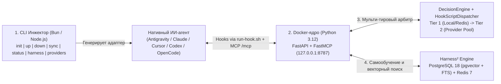

# 🏭 mcp-coop-agentic-factory

**Автономный самообучающийся ИИ-харнес («Фабрика агентов»)** — глобальный центр управления знаниями, правилами, скиллами и хуками для 5 нативных ИИ-агентов (**Google Antigravity**, **Claude Code**, **Cursor**, **OpenAI Codex CLI**, **OpenCode CLI**).

Превращает любую локальную папку проекта в управляемую рабочую зону одной командой, не засоряя хост-машину, хранит профиль проекта и эволюционирующие компоненты в **PostgreSQL 18 (`pgvector`) + Redis 7** внутри Docker и переносит выученный инженерный опыт между проектами.

---

## ⚡ Быстрый старт

Перейдите в любую папку вашего проекта и выполните:

```bash
mcp-coop-agentic-factory init
# или через bunx / npx:
bunx mcp-coop-agentic-factory init
npx mcp-coop-agentic-factory init
```

**Что произойдёт автоматически:**
1. Интерактивный TUI-визард (`@clack/prompts`) предложит выбрать целевого ИИ-агента и теги технологического стека проекта (`typescript`, `bun`, `python`, `fastapi`, `docker` и т.д.).
2. В `~/.mcp-coop-agentic-factory/` синхронизируются файлы стека, создастся универсальный рантайм-лончер хуков `~/.mcp-coop-agentic-factory/bin/run-hook.sh` и поднимется глобальное Docker-ядро (`postgres`, `redis`, `core`).
3. Профиль проекта (`agent_type`, `stack_tags`, `profile_overrides`) сохранится в таблицу `projects` в PostgreSQL (единый источник истины — без дублирующих JSON-конфигов в `.context/`).
4. В рабочей папке сгенерируется нативный плагин/адаптер выбранного агента и развернётся локальный граф контекста `.context/` (`Graph-as-Code`: `schema.md` + `index.md` + `entities/`).

---

## 🧠 Архитектура (4 слоя + Шина хуков с векторным отбором скриптов)



1. **Слой 1 — Dual-Runtime CLI Инжектор (`src/cli/`):** Работает как под **Bun**, так и под **Node.js**. Управляет жизненным циклом глобального Docker-стека, материализует файлы адаптеров и предоставляет тонкий HTTP-мост хуков (`hook_runner.ts`).
2. **Слой 2 — Изолированное Docker-ядро (`~/.mcp-coop-agentic-factory/`):** Три контейнера:
   * `mcp-coop-agentic-factory-core` (`127.0.0.1:8787`) — `FastAPI` + `FastMCP` (`Python 3.12 Slim`).
   * `mcp-coop-agentic-factory-postgres` (`127.0.0.1:54329`) — `pgvector/pgvector:pg18` (БД `mcp_coop_agentic_factory`, пользователь `mcp_coop`).
   * `mcp-coop-agentic-factory-redis` (`127.0.0.1:63799`) — `redis:7-alpine` (оперативный стейт сессий `session:{id}:meta`, анти-луп и LangCache).
3. **Слой 3 — Шина хуков (`HookScriptDispatcher`) и `DecisionEngine` (`src/core/`):**
   * Хуки (`session-start`, `pre-invocation`, `pre-tool-use`, `post-tool-use`, `stop`) работают как чистая шина событий.
   * Исполняемые Python-скрипты (`component_type = 'script'`: `inject-context-map`, `track-file-changes`, `enforce-context-sync` и любые пользовательские скрипты) хранятся в PostgreSQL (`harness_components`) с векторами `embedding vector(768)` и отбираются под конкретный проект и событие через двухступенчатую воронку (`always` + семантический Top-K `pgvector`).
4. **Слой 4 — Эволюционирующий `Harness²` и `.context/` Graph-as-Code:** Цикл **Propose → Probe → Compose** с разделением знаний на глобальные (`global`) и стековые (`domain`).

---

## 💻 Команды CLI

```bash
# Жизненный цикл проекта и Docker-стека
mcp-coop-agentic-factory init                        # Интерактивный визард инициализации проекта и запуск Docker
mcp-coop-agentic-factory up                          # Запустить глобальный Docker-стек после остановки (без визарда)
mcp-coop-agentic-factory down                        # Корректно остановить глобальный Docker-стек
mcp-coop-agentic-factory sync                        # Синхронизировать файлы проекта с профилем в PostgreSQL
mcp-coop-agentic-factory status                      # Статус контейнеров, БД, пула провайдеров и стека проекта из БД

# Управление компонентами, хуками и тегами проекта (Harness²)
mcp-coop-agentic-factory harness list [--all] [--type <t>] [--tag <tag>]
mcp-coop-agentic-factory harness enable <slug> [-g]  # Включить компонент для проекта (или глобально в БД с -g)
mcp-coop-agentic-factory harness disable <slug> [-g] # Выключить компонент для проекта (или глобально в БД с -g)
mcp-coop-agentic-factory harness hook-enable <event> # Включить жизненный хук (session-start, pre-tool-use, stop и др.)
mcp-coop-agentic-factory harness hook-disable <event>
mcp-coop-agentic-factory harness tag-add <tag>       # Добавить стековый тег проекту в PostgreSQL
mcp-coop-agentic-factory harness tag-exclude <tag>   # Исключить стековый тег проекта

# Горячее управление пулом LLM-провайдеров второго контура (Tier 2 Decision Pool)
mcp-coop-agentic-factory providers list
mcp-coop-agentic-factory providers add <name> --dialect <d> --url <u> --model <m> --key <k> [--priority <p>]
mcp-coop-agentic-factory providers enable <name>
mcp-coop-agentic-factory providers disable <name>
mcp-coop-agentic-factory providers priority <name> <prio>
mcp-coop-agentic-factory providers reset <name>      # Сбросить Circuit Breaker провайдера в Redis
mcp-coop-agentic-factory providers remove <name>
```

---

## 🔍 Полезные команды диагностики Docker, PostgreSQL и Redis

> **Важно:** в `psql` используйте флаг `-P pager=off`, чтобы вывод таблиц печатался сразу в терминал без интерактивного режима `(END)`.

```bash
# 1. Проверить зарегистрированные проекты и их теги/оверрайды в PostgreSQL
docker exec -it mcp-coop-agentic-factory-postgres psql -U mcp_coop -d mcp_coop_agentic_factory -P pager=off \
  -c "SELECT name, agent_type, stack_tags, profile_overrides FROM projects;"

# 2. Проверить все компоненты и скрипты хуков в таблице harness_components
docker exec -it mcp-coop-agentic-factory-postgres psql -U mcp_coop -d mcp_coop_agentic_factory -P pager=off \
  -c "SELECT slug, component_type, scope, stack_tags, metadata->>'hook_events' AS hooks, usage_count, status FROM harness_components;"

# 3. Проверить лог срабатывания жизненных хуков
docker exec -it mcp-coop-agentic-factory-postgres psql -U mcp_coop -d mcp_coop_agentic_factory -P pager=off \
  -c "SELECT id, event_type, tool_name, decision, created_at FROM hook_events ORDER BY id DESC LIMIT 10;"

# 4. Проверить активные ключи сессий и кэша в Redis
docker exec -it mcp-coop-agentic-factory-redis redis-cli KEYS "*"
```

---

## 🔌 Инструменты локального MCP-сервера (`http://127.0.0.1:8787/mcp`)

Нативный агент получает доступ к **8 инструментам** внутри контейнера `mcp-coop-agentic-factory-core`:
1. `coop_search_memory` — гибридный векторно-полнотекстовый поиск (`pgvector` + `tsvector` + `pg_trgm`) решений ошибок и паттернов.
2. `coop_learn_memory` — сохранение найденного решения нетривиальной ошибки в долгосрочную память `memories`.
3. `coop_propose_harness_edit` — создание/обновление любого компонента `Harness²` (`system_prompt`, `guardrail`, `skill`, `tool_guidance`, `script`, `subagent`) с автоматической векторизацией.
4. `coop_publish_skill` — публикация переиспользуемого навыка (`SKILL.md` + вспомогательные скрипты).
5. `coop_query_context_graph` — извлечение локального подграфа окрестности узла из `.context/` (`NetworkX DiGraph`).
6. `coop_upsert_context_node` — атомарное создание/обновление узла графа `.context/entities/` с проверкой инвариантов `No Phantom Nodes` и `No Broken Links`.
7. `coop_get_factory_status` — сводка здоровья PostgreSQL/Redis, пула провайдеров Tier 2 и статистики компонентов.
8. `coop_manage_decision_providers` — рантайм-управление провайдерами второго контура оценки (`list` / `update`).

---

## 📄 Документация и спецификации (Spec-Driven)

* [**`SPEC.md`**](./SPEC.md) — Базовая архитектурная спецификация системы (v0.1: 4 слоя, схема БД, диалекты 5 агентов, `DecisionEngine`, `FastMCP`).
* [**`TASK_SPEC.md`**](./TASK_SPEC.md) — Спецификация следующего этапа развития (**v0.2**: минимальный Bootstrap в плагине, 100% динамический RAG скиллов и правил через хук `PreInvocation`, двусторонний `sync` локальных наработок и графа `.context/` по `updated_at`, а также серверная консолидация/слияние похожих скиллов по векторам `pgvector`).
* [**`.context/index.md`**](./.context/index.md) — Точка входа в живой граф знаний репозитория (`Graph-as-Code`).
