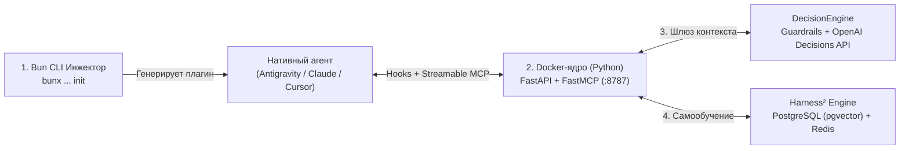

# 🏭 mcp-coop-agentic-factory

**Автономный самообучающийся ИИ-харнес («Фабрика агентов»)** — глобальный центр управления знаниями, правилами и скилами для нативных ИИ-агентов (**Antigravity**, **Claude Code**, **Cursor**).

Превращает любую локальную папку проекта в управляемую рабочую зону одной командой, не засоряя хост-машину, предотвращает галлюцинации и переносит выученный инженерный опыт между проектами.

---

## ⚡ Быстрый старт (One-Command Init)

Перейдите в любую папку вашего проекта и выполните:

```bash
bunx mcp-coop-agentic-factory init
```

**Что произойдёт автоматически:**
1. Поднимется глобальное изолированное Docker-ядро в `~/.mcp-coop-agentic-factory/` (если ещё не запущено).
2. Определится технологический стек проекта (`typescript`, `bun`, `python`, `docker` и т.д.).
3. Сгенерируется нативный плагин `.agents/plugins/mcp-coop-agentic-factory/` с правилами (`AGENTS.md`), скилами (`SKILL.md`), MCP-подключением (`mcp_config.json`) и жизненными хуками (`hooks.json`).
4. Развернётся локальный граф контекста `.context/` (`Graph-as-Code`: `schema.md` + `index.md`) с тройным контуром контроля актуальности.

---

## 🧠 Как это работает (4 слоя)



1. **Слой инициализации (Bun CLI):** Тонкий инжектор на хосте. Сканирует стек папки и настраивает локальные хуки и плагин агента.
2. **Слой изоляции (Глобальное Docker-ядро):** Постоянно работающий стек из 3 лёгких контейнеров (`mcp-coop-agentic-factory-core` на Python 3.12 ~50–70 МБ RAM, `PostgreSQL 16 + pgvector`, `Redis 7`). Хост-машина остаётся абсолютно чистой.
3. **Шлюз контекста (`DecisionEngine`):** Перехватывает события `SessionStart`, `PreInvocation`, `PreToolUse`, `PostToolUse` и `Stop`. Блокирует опасные команды, перезаписывает неверные вызовы (`npm` → `bun`), останавливает зацикливание на ошибках и подкладывает готовые решения из памяти.
4. **Самообучение (`Harness²` Loop):** Реализует архитектуру [Google Research Harness²](https://github.com/google-research/harness2) (цикл **Propose → Probe → Compose** по 8 компонентам окружения). Когда агент решает сложную проблему в **Проекте А**, знание сохраняется в глобальное ядро и автоматически раскатывается в **Проект Б**.

---

## 🛠 Технологический стек и интеграции

| Компонент | Технология | Роль в системе |
| :--- | :--- | :--- |
| **CLI & Hook Bridge** | **Bun (TypeScript)** | Мгновенный запуск `init` и проброс `stdin/stdout` хуков без зависимостей на хосте |
| **Core & MCP Server** | **Python 3.12 (`FastAPI` + `FastMCP`)** | Обработка хуков и локальный MCP-сервер по протоколу Streamable HTTP (`/mcp`) |
| **Память и поиск** | **PostgreSQL 16 (`pgvector` + FTS) & Redis 7** | Гибридный поиск решений (`tsvector` + `pg_trgm` + векторы) и анти-луп кэш сессий |
| **Эволюция агента** | **Google Research `Harness²`** | Разделение опыта на `invariant` (глобальный) и `domain-specific` (по тегам стека) |
| **Оценка решений** *(опц.)* | **OpenAI `Decisions API`** | Вызовы `Predicate` / `Choice` / `Score` для сложных проверок с нулевой ценой выходных токенов |
| **Эмбеддинги** *(опц.)* | **`EmbeddingGemma 2` API** | Внешний HTTP-клиент (`768-dim`) без локального PyTorch и нагрузки на RAM |

---

## 💻 Команды CLI

```bash
bunx mcp-coop-agentic-factory init     # Инициализировать харнес и плагин в текущем проекте
bunx mcp-coop-agentic-factory sync     # Принудительно подтянуть свежие правила и скилы из ядра
bunx mcp-coop-agentic-factory status   # Проверить статус Docker-ядра, БД и количество правил/скилов
bunx mcp-coop-agentic-factory down     # Остановить глобальное Docker-ядро
```

---

## 🔌 Инструменты локального MCP-сервера (`:8787/mcp`)

Нативный агент получает доступ к 5 инструментам внутри контейнера:
* `coop_search_memory` — гибридный поиск решений ошибок и архитектурных паттернов по всем проектам.
* `coop_learn_memory` — сохранение найденного решения нетривиальной ошибки в глобальную память.
* `coop_propose_harness_edit` — предложение и валидация правок в 8 компонентов `Harness²` (`Propose → Probe → Compose`).
* `coop_publish_skill` — публикация переиспользуемого скила (`SKILL.md` + скрипты) для автоматической раскатки в другие проекты.
* `coop_get_factory_status` — сводка активных правил, скилов и статуса ядра.

---

## 📄 Документация и разработка (Spec-Driven)

Проект разрабатывается по методологии **Spec-Driven Development**.  
Полная архитектурная спецификация, схема БД и контракты хуков описаны в [**SPEC.md**](./SPEC.md).

