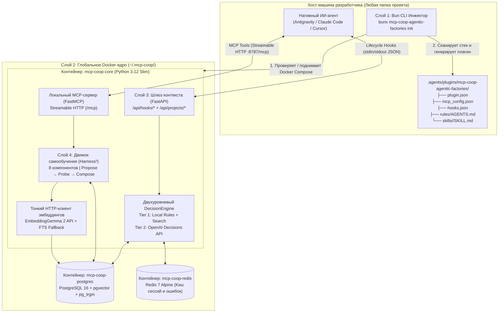

# Техническая спецификация (SPEC): `mcp-coop-agentic-factories`

> **Статус документа:** Draft v1.0 (Spec-Driven Development)  
> **Назначение:** Единый источник истины (Single Source of Truth) перед этапом планирования и написания кода.

---

## 1. Суть и концепция системы

**`mcp-coop-agentic-factories`** — автономный, самообучающийся инфраструктурный слой («Фабрика агентов») для ИИ-ассистированной инженерии.  
Система работает как изолированный глобальный центр управления знаниями и качеством разработки, который перехватывает, координирует и эволюционирует поведение нативных ИИ-агентов (**Antigravity** в первой версии, с архитектурным расширением под **Claude Code** и **Cursor**) в любом локальном проекте разработчика.

### Ключевая парадигма
1. **Хост-машина остаётся абсолютно чистой:** На хосте запускается только легковесный CLI-инжектор на **Bun** (`bunx mcp-coop-agentic-factories init`), который не тянет за собой ни баз данных, ни ML-библиотек.
2. **Вся аналитика и память — в глобальном Docker-стеке:** Постоянно работающее в фоне ядро на **Python (`FastAPI` + `FastMCP`) + PostgreSQL (`pgvector` + FTS) + Redis** обслуживает сразу все локальные проекты разработчика.
3. **Эволюция без переобучения весов (`Harness²`):** Вместо модификации весов LLM система оптимизирует **харнес** (окружение вокруг агента) по методологии **Google Research `Harness²`** через цикл **Propose → Probe → Compose**, разделяя накопленный опыт на **инвариантный** (`invariant`, глобальный для всех проектов) и **доменно-специфичный** (`domain-specific`, по тегам технологического стека).

---

## 2. Высокоуровневая архитектура (4 слоя)



---

## 3. Детальная спецификация по слоям

### 3.1. Слой 1: Слой инициализации и CLI-триггер (Хостовый пакет на Bun)

* **Среда выполнения:** Bun (TypeScript).
* **Точка входа:** `bunx mcp-coop-agentic-factories <command>`.
* **Команды CLI:**
  1. `init [--agent antigravity|claude|cursor]` — инициализация харнеса в текущей рабочей директории:
     - Проверяет доступность глобального Docker-ядра (`GET http://127.0.0.1:8787/health`).
     - Если ядро не запущено — автоматически разворачивает конфигурацию Docker Compose в `~/.mcp-coop/runtime/` и выполняет `docker compose up -d --build`.
     - Запускает **Stack Detector**: сканирует файлы проекта (`package.json`, `bun.lockb`, `tsconfig.json`, `pyproject.toml`, `requirements.txt`, `Dockerfile`, `docker-compose.yml`, `Cargo.toml`, `go.mod`) и формирует массив тегов стека (например: `["global", "typescript", "bun", "docker"]`).
     - Запускает **Agent Detector**: определяет активного ИИ-агента по окружению и директориям (по умолчанию **Antigravity**, с возможностью явного выбора или автоопределения).
     - Регистрирует проект в Python-ядре (`POST /api/projects/register`) и получает скомпилированный срез всех 8 компонентов харнеса под стек проекта.
     - Записывает нативный адаптер-плагин в папку проекта.
  2. `hook <event>` — ультра-быстрый легковесный мост для `hooks.json`:
     - Читает JSON-контекст хука из `stdin`.
     - Пересылает его в `POST http://127.0.0.1:8787/api/hooks/<event>`.
     - При получении обновлённых файлов (`sync_bundle` при `session-start`) атомарно записывает их на диск в папку плагина.
     - Выводит ответный JSON-контракт в `stdout` (с fail-open фолбэком `{}` / `{"decision": "allow"}`, если Docker принудительно остановлен пользователем, чтобы не сломать работу IDE).
  3. `sync` — принудительная синхронизация правил и скилов из глобального Docker-ядра в текущий проект.
  4. `status` — вывод состояния контейнеров, количества инвариантных и доменных правил, скилов и записей в памяти.
  5. `down` — корректная остановка глобального Docker-стека.

#### Спецификация генерируемого плагина для Antigravity
В целевом проекте создаётся директория `.agents/plugins/mcp-coop-agentic-factories/`:

```text
.agents/plugins/mcp-coop-agentic-factories/
├── plugin.json                # Манифест плагина: { "name": "mcp-coop-agentic-factories" }
├── mcp_config.json            # Подключение к локальному Python MCP-серверу в Docker
├── hooks.json                 # Перехват всех фаз жизненного цикла агента
├── rules/
│   └── AGENTS.md              # Скомпилированные System Prompt + Tool Guidance + Guardrails
└── skills/
    └── <skill-name>/
        ├── SKILL.md           # Манифест и инструкции скила с YAML frontmatter
        └── scripts/           # Опциональные исполняемые скрипты (компонент Scripts из Harness²)
```

* **`mcp_config.json`**:
  ```json
  {
    "mcpServers": {
      "mcp-coop-factory": {
        "url": "http://127.0.0.1:8787/mcp"
      }
    }
  }
  ```
* **`hooks.json`**: регистрирует обработчик `mcp-coop-guard` на события `SessionStart`, `PreInvocation`, `PreToolUse` (`matcher: "*"`), `PostToolUse` (`matcher: "*"`) и `Stop`.

---

### 3.2. Слой 2: Слой изоляции (Глобальное Docker-ядро на Python)

* **Расположение глобального стейта на хосте:** `~/.mcp-coop/`.
* **Конфигурация `~/.mcp-coop/.env`:** хранит опциональные API-ключи (`OPENAI_API_KEY` для Decisions API, `GEMINI_API_KEY` / `HF_TOKEN` для внешнего API `EmbeddingGemma 2`).
* **Топология `docker-compose.yml` (3 контейнера):**

| Контейнер | Образ | Назначение и ресурсы |
| :--- | :--- | :--- |
| **`mcp-coop-core`** | `python:3.12-slim` | Единый асинхронный ASGI-сервер (`FastAPI` + `FastMCP` + `uvicorn`) на порту `8787`. Без локального PyTorch/CUDA — потребление RAM **~50–70 МБ**. |
| **`mcp-coop-postgres`** | `pgvector/pgvector:pg16` | Персистентное хранилище проектов, 8 компонентов `Harness²`, логов перехвата, полнотекстового индекса (`tsvector` + `pg_trgm`) и векторов (`vector(768)`). |
| **`mcp-coop-redis`** | `redis:7-alpine` | Оперативная память активных сессий (`conversationId`), счётчики зацикливания команд, кэш скомпилированных правил для суб-миллисекундного ответа в хуках. |

---

### 3.3. Слой 3: Слой перехвата и протоколирования (Шлюз контекста и `DecisionEngine`)

Все действия нативного агента проходят через двусторонние хуки в `FastAPI` (`/api/hooks/<event>`).

#### Контракты обработки событий жизненных хуков (Antigravity Contract)

1. **`SessionStart` (`POST /api/hooks/session-start`)**:
   - **Вход:** `conversationId`, `workspacePaths`, `modelName`.
   - **Действие в ядре:**
     - Находит проект по `workspacePaths[0]` (или автоматически регистрирует его).
     - Собирает актуальные **Invariant** (`global`) и **Domain-Specific** (по стеку проекта) компоненты `Harness²` из БД.
     - Инициализирует ключ сессии в Redis (`session:{conversationId}`).
   - **Выход:**
     - Поле `injectSteps`: инжектит стартовый `systemMessage` с кратким резюме активных инвариантных правил и доступных MCP-инструментов фабрики.
     - Внутреннее поле для CLI-моста (`_syncFiles`): передаёт новые/обновлённые файлы `rules/AGENTS.md` и `skills/*/SKILL.md`, которые CLI-мост мгновенно сохраняет в `.agents/plugins/mcp-coop-agentic-factories/` до первого шага агента.

2. **`PreToolUse` (`POST /api/hooks/pre-tool-use`)**:
   - **Вход:** `conversationId`, `stepIdx`, `toolCall: { name, args }`.
   - **Действие в `DecisionEngine`:**
     - **Tier 1 (Детерминированные Guardrails из Redis/Postgres, <5 мс):**
       - Проверка по правилам `block_command` (например, запрет `rm -rf /`, `git push --force` в защищённые ветки, чтение секретов).
       - Проверка по правилам `rewrite_command` (например, в проекте с тегом `bun` команда `npm install` или `npx` автоматически переписывается через `overwrite`).
       - Проверка в Redis на **анти-зацикливание**: если агент пытается вызвать в точности ту же команду с теми же аргументами, которая уже упала с ошибкой 2 раза подряд в текущей сессии -> возвращается `decision: "deny"` с объяснением причины и требованием сменить подход.
     - **Tier 2 (OpenAI Decisions API — опционально при наличии `OPENAI_API_KEY`):**
       - Если команда помечена как потенциально рискованная (неоднозначный паттерн), отправляется быстрый запрос в OpenAI Decisions API (`Predicate`: вероятность нарушения правил безопасности `0..1` + `Choice`: `allow | ask | deny`).
   - **Выход (stdout):**
     ```json
     {
       "decision": "allow | deny | ask | force_ask",
       "reason": "Описание причины (при deny/ask)",
       "overwrite": { "CommandLine": "..." }
     }
     ```

3. **`PostToolUse` (`POST /api/hooks/post-tool-use`)**:
   - **Вход:** `conversationId`, `stepIdx`, `toolCall`, `error` (если вызов завершился ошибкой).
   - **Действие в ядре:**
     - Логирует событие в `hook_events`.
     - Если `error` не пустой: записывает симптомы ошибки и вызванную команду в Redis (`session:{conversationId}:last_error`) и увеличивает счётчик сбоев этой команды (`session:{conversationId}:fail_count:{hash}`).
     - Если `error` отсутствует, но ранее в сессии была зафиксирована ошибка: помечает в Redis, что агент нашёл рабочий обходной путь (`session:{conversationId}:resolved_error = true`), создавая кандидата для фазы **Propose** в `Harness²`.
   - **Выход (stdout):** `{}`.

4. **`PreInvocation` (`POST /api/hooks/pre-invocation`)**:
   - **Вход:** `conversationId`, `invocationNum`.
   - **Действие в ядре (Анти-галлюцинации и динамический RAG по памяти):**
     - Проверяет Redis: есть ли неразрешённая ошибка с предыдущего шага (`last_error`).
     - Если ошибка есть: выполняет поиск по таблице `memories` (сначала через векторный поиск `pgvector`, если настроен API `EmbeddingGemma 2`, либо через мгновенный встроенный гибрид `tsvector + pg_trgm` в Postgres).
     - Если найдено проверенное решение из прошлых проектов (например, из Проекта А) — формирует `ephemeralMessage` с готовой подсказкой и решением.
   - **Выход (stdout):**
     ```json
     {
       "injectSteps": [
         {
           "ephemeralMessage": "[MCP-COOP Factory Hint]: На предыдущем шаге возникла ошибка ... В глобальной памяти есть проверенное решение: ..."
         }
       ]
     }
     ```

5. **`Stop` (`POST /api/hooks/stop`)**:
   - **Вход:** `conversationId`, `terminationReason`, `error`.
   - **Действие в ядре (Замкнутый цикл рефлексии `Harness²`):**
     - Проверяет флаг `resolved_error` в Redis для данной сессии.
     - Если в ходе сессии агент столкнулся с нетривиальной ошибкой и успешно её преодолел, но ещё не сохранил паттерн через MCP-тул (и мы ещё не просили его об этом в этой сессии — флаг `reflection_prompted = false` в Redis), хук один раз возвращает `decision: "continue"` с `reason`, предлагающим агенту зафиксировать выученное решение или скил через MCP-инструмент `coop_propose_edit` / `coop_learn_memory`.
   - **Выход (stdout):** `{"decision": "allow"}` (или `{"decision": "continue", "reason": "..."}`).

---

### 3.4. Слой 4: Интеллектуальный контур `Harness²` (8 компонентов + Propose–Probe–Compose)

В соответствии с архитектурой **`google-research/harness2`**, мы моделируем окружение агента как 8 редактируемых компонентов, хранящихся в PostgreSQL и материализуемых в плагин проекта:

| № | Компонент `Harness²` | Хранение в PostgreSQL (`component_type`) | Материализация в проекте (Antigravity) |
| :- | :--- | :--- | :--- |
| 1 | **System Prompt** | `system_prompt` | Верхняя секция в `rules/AGENTS.md` |
| 2 | **Guardrails** | `guardrail` (`block_command` / `rewrite_command`) | Исполняется в `PreToolUse` + документируется в `rules/AGENTS.md` |
| 3 | **Memory** | Таблица `memories` (симптом, решение, вектор/FTS) | Инжектится динамически в `PreInvocation` + поиск через MCP |
| 4 | **Skills** | `skill` (YAML frontmatter + Markdown-ранбук) | Файлы `.agents/plugins/.../skills/<name>/SKILL.md` |
| 5 | **Tool Guidance** | `tool_guidance` | Секция правил работы с тулами в `rules/AGENTS.md` |
| 6 | **Scripts** | `script` (привязанный к скилу исполняемый скрипт) | Файлы `.agents/plugins/.../skills/<name>/scripts/<file>` |
| 7 | **Subagents** | `subagent` (описание роли и промпта субагента) | Секция делегирования / определения субагентов |
| 8 | **Middleware Plugin** | `middleware` (конфигурация перехвата) | `hooks.json` и `mcp_config.json` |

#### Два типа правок (Scope)
* **`invariant` (`scope = 'global'`)**: Универсальные правила и навыки инженерии, не зависящие от языка (например: безопасность команд, работа с Git, общие паттерны отладки). Применяются ко **всем** проектам.
* **`domain_specific` (`scope = 'domain'`, `tags = ['typescript', 'bun', ...]`)**: Знания, привязанные к конкретному стеку или фреймворку. Применяются только к проектам с пересекающимися тегами стека.

#### Стейт-машина эволюции: `Propose → Probe → Compose`
1. **Propose (Предложение):**
   - Когда агент решает сложную проблему в Проекте А (или обнаруживает полезный паттерн/правило), он вызывает MCP-инструмент (или ядро создаёт предложение из логов сессии).
   - Компонент сохраняется со статусом `status = 'candidate'` (или сразу `'composed'`, если уверенность высокая / подтверждено оценкой).
2. **Probe (Проверка и скоринг):**
   - При последующих срабатываниях кандидата ядро отслеживает метрику успешности (`success_count` vs `failure_count` в сессиях, где этот кандидат был применён).
   - При наличии ключа `OPENAI_API_KEY` вызывается **OpenAI Decisions API (`Score` + `Predicate`)** для оценки качества предложенного правила/скила по инженерной рубрике (ясность, отсутствие конфликтов, переиспользуемость).
3. **Compose (Включение в базовый харнес):**
   - Валидированные правки получают статус `status = 'composed'`, увеличивают глобальную версию харнеса и автоматически раскатываются во все подходящие проекты при следующем `SessionStart` или `bunx mcp-coop-agentic-factories sync`.

---

### 3.5. Локальный граф контекста проекта (`.context/` Graph-as-Code) и Тройной контур принуждения

В каждом подключённом проекте поддерживается версионируемый в Git инженерный граф контекста в папке `.context/` (формат Markdown + YAML Frontmatter + `[[wiki-links]]`).

#### 1. Структура и онтология `.context/`
```text
my-project/
└── .context/
    ├── schema.md              # Онтология и правила валидации графа (Nodes & Edges)
    ├── index.md               # Точка входа (карта реально существующих узлов)
    └── entities/
        ├── modules/           # Модули кода (mod-*.md) со списком реальных файлов files: [...]
        ├── contracts/         # Интерфейсы, API, схемы БД и хуков (contract-*.md)
        └── decisions/         # Архитектурные решения ADR (adr-*.md)
```
* **Золотое правило честности графа (No Phantom Nodes):** Узлы в `.context/entities/` создаются **строго для реально существующих на диске файлов и реализованных контрактов**. Никаких фантомных файлов «на будущее» или отдельной папки `relations/`. Все связи (`depends_on`, `implements`, `governed_by`) хранятся внутри YAML-шапки и тела самого узла.

#### 2. Тройной контур принуждения (3-Layer Context Enforcement)
Чтобы агент в каждом новом чате гарантированно читал граф и обновлял его после изменений кода (даже если глобальный Docker временно выключен), работает трёхуровневая защита:

* **Контур 1 (`Always-On` правило в `AGENTS.md`):** Обязывает агента начинать анализ задачи с `.context/index.md` и обновлять затронутые узлы + секцию `## Логи контекста (AI Traces)`.
* **Контур 2 (`SessionStart` Hook — Авто-инъекция карты):** При старте любого нового чата хук читает `.context/index.md` и инжектит актуальную карту узлов прямо в `systemMessage` первого шага.
* **Контур 3 (`PostToolUse` + `Stop` Hook — Контроль синхронизации):**
  - Если в ходе сессии агент изменил файлы кода (`src/*` и др.), фиксируется флаг `code_modified = true` (локально в `/tmp/mcp-coop-session-<id>.json` и дублируется в Redis при активном Docker-ядре).
  - Если агент обновил `.context/entities/*` или `.context/index.md`, ставится флаг `context_updated = true`.
  - При попытке завершить ответ (`Stop`), если `code_modified == true` и `context_updated == false`, хук блокирует остановку (`{"decision": "continue", "reason": "..."}`) и требует актуализировать `.context/`.

#### 3. Парсинг и обход графа в Python-ядре (`NetworkX` + `Pydantic`)
* Внутри `mcp-coop-core` модуль `src/core/graph/context_graph.py` парсит YAML-шапки и `[[wiki-ссылки]]` в ориентированный граф `NetworkX` (`DiGraph`), проверяя целостность ссылок и существование файлов из поля `files: [...]`.

---

## 4. Спецификация базы данных (PostgreSQL + pgvector и Redis)

### 4.1. Таблицы PostgreSQL

```sql
CREATE EXTENSION IF NOT EXISTS vector;
CREATE EXTENSION IF NOT EXISTS pg_trgm;

-- 1. Зарегистрированные локальные проекты
CREATE TABLE projects (
    id UUID PRIMARY KEY DEFAULT gen_random_uuid(),
    workspace_path TEXT UNIQUE NOT NULL,
    name TEXT NOT NULL,
    agent_type TEXT NOT NULL DEFAULT 'antigravity',
    stack_tags TEXT[] NOT NULL DEFAULT ARRAY['global'],
    last_synced_at TIMESTAMPTZ DEFAULT NOW(),
    created_at TIMESTAMPTZ DEFAULT NOW()
);

-- 2. Компоненты харнеса (Harness²: System Prompt, Guardrails, Skills, Tool Guidance, Scripts, Subagents)
CREATE TABLE harness_components (
    id UUID PRIMARY KEY DEFAULT gen_random_uuid(),
    slug TEXT UNIQUE NOT NULL,
    component_type TEXT NOT NULL, -- 'system_prompt' | 'guardrail' | 'skill' | 'tool_guidance' | 'script' | 'subagent'
    scope TEXT NOT NULL DEFAULT 'global', -- 'global' (invariant) | 'domain' (domain-specific)
    stack_tags TEXT[] NOT NULL DEFAULT ARRAY['global'],
    title TEXT NOT NULL,
    description TEXT NOT NULL DEFAULT '',
    content TEXT NOT NULL, -- Markdown-контент (для правил/скилов) или код скрипта
    metadata JSONB NOT NULL DEFAULT '{}'::jsonb, -- Для guardrail: {action: 'deny'|'overwrite', matcher: 'run_command', pattern: '...', replacement: '...'}
    status TEXT NOT NULL DEFAULT 'composed', -- 'candidate' (Propose) | 'probing' (Probe) | 'composed' (Compose) | 'rejected'
    score REAL NOT NULL DEFAULT 1.0,
    usage_count INT NOT NULL DEFAULT 0,
    source_project_path TEXT,
    version INT NOT NULL DEFAULT 1,
    updated_at TIMESTAMPTZ DEFAULT NOW(),
    created_at TIMESTAMPTZ DEFAULT NOW()
);

-- 3. Сквозная база опыта и решений ошибок (Memory компонент из Harness²)
CREATE TABLE memories (
    id UUID PRIMARY KEY DEFAULT gen_random_uuid(),
    title TEXT NOT NULL,
    error_symptom TEXT NOT NULL,
    solution TEXT NOT NULL,
    scope TEXT NOT NULL DEFAULT 'global',
    stack_tags TEXT[] NOT NULL DEFAULT ARRAY['global'],
    embedding vector(768), -- Опциональный вектор от EmbeddingGemma 2 API (768-dim)
    search_tsv tsvector GENERATED ALWAYS AS (
        to_tsvector('simple', coalesce(title, '') || ' ' || coalesce(error_symptom, '') || ' ' || coalesce(solution, ''))
    ) STORED,
    helpful_count INT NOT NULL DEFAULT 0,
    source_project_path TEXT,
    created_at TIMESTAMPTZ DEFAULT NOW()
);

CREATE INDEX idx_memories_tsv ON memories USING GIN (search_tsv);
CREATE INDEX idx_memories_symptom_trgm ON memories USING GIN (error_symptom gin_trgm_ops);

-- 4. Лог перехватов и событий жизненных хуков
CREATE TABLE hook_events (
    id BIGSERIAL PRIMARY KEY,
    conversation_id TEXT NOT NULL,
    workspace_path TEXT,
    event_type TEXT NOT NULL, -- 'session-start' | 'pre-tool-use' | 'post-tool-use' | 'pre-invocation' | 'stop'
    tool_name TEXT,
    payload JSONB NOT NULL DEFAULT '{}'::jsonb,
    decision JSONB NOT NULL DEFAULT '{}'::jsonb,
    created_at TIMESTAMPTZ DEFAULT NOW()
);
```

### 4.2. Ключи Redis (TTL = 24 часа)
* `session:{conversationId}:meta` (Hash) — `workspace_path`, `resolved_error` (`0|1`), `reflection_prompted` (`0|1`).
* `session:{conversationId}:last_error` (JSON) — `{ tool_name, command, error_text, step_idx }`.
* `session:{conversationId}:cmd_fails:{cmd_hash}` (Int) — счётчик последовательных падений идентичной команды для блокировки зацикливания.

---

## 5. Спецификация локального MCP-сервера (`FastMCP` в Python-ядре)

MCP-сервер поднимается внутри контейнера `mcp-coop-core` и доступен по адресу `http://127.0.0.1:8787/mcp` (Streamable HTTP). Он предоставляет нативному агенту 7 инструментов:

1. **`coop_search_memory(query: str, stack_tags: list[str] = [])`**
   - Ищет решённые ошибки, архитектурные паттерны и правила во всех проектах (гибридный поиск: `pgvector` косинусная близость через API `EmbeddingGemma 2` при наличии ключа + PostgreSQL `tsvector` и `pg_trgm`).
2. **`coop_learn_memory(title: str, error_symptom: str, solution: str, stack_tags: list[str] = ["global"])`**
   - Сохраняет найденное решение нетривиальной ошибки или проблемы в сквозную память `memories`. Мгновенно становится доступным для `PreInvocation`-подсказок во всех остальных проектах.
3. **`coop_propose_harness_edit(component_type: str, slug: str, title: str, description: str, content: str, scope: str = "global", stack_tags: list[str] = ["global"], metadata: dict = {})`**
   - Универсальный инструмент цикла **Harness² (`Propose → Probe → Compose`)**: позволяет агенту создать или обновить любой из компонентов харнеса (`system_prompt`, `guardrail`, `skill`, `tool_guidance`, `script`, `subagent`).
   - Прогоняет правку через `DecisionEngine` (локальный валидатор + опциональный `Score`/`Predicate` через OpenAI `Decisions API`) и переводит в статус `composed`.
4. **`coop_publish_skill(slug: str, description: str, instructions_md: str, stack_tags: list[str] = ["global"], helper_scripts: dict[str, str] = {})`**
   - Удобная обёртка для публикации готового переиспользуемого скила (`SKILL.md` + опциональные скрипты в `scripts/`), который автоматически материализуется на диск во всех проектах с подходящим стеком.
5. **`coop_query_context_graph(workspace_path: str, node_id: str = "", depth: int = 2)`**
   - Строит `NetworkX`-граф по папке `.context/` проекта и возвращает агенту запрошенный узел вместе со всеми связанными узлами (`depends_on`, `implements`, `governed_by`) на глубину `depth` + проверяет отсутствие битых ссылок.
6. **`coop_upsert_context_node(workspace_path: str, entity_class: str, node_id: str, name: str, files: list[str], body_md: str, trace_note: str, ...)`**
   - Создаёт или обновляет реальный MD-узел в `.context/entities/`, добавляет датированную запись в `## Логи контекста (AI Traces)` и синхронизирует `.context/index.md`.
7. **`coop_get_factory_status(workspace_path: str = "")`**
   - Возвращает текущую конфигурацию фабрики, список активных правил, скилов, статистику перехватов и статус интеграций (`Decisions API`, `EmbeddingGemma 2 API`).

---

## 6. Внешние опциональные интеграции (API-адаптеры без утяжеления контейнера)

1. **OpenAI `Decisions API` (`src/core/services/decisions_api.py`):**
   - Если в окружении контейнера задан `OPENAI_API_KEY`, модуль использует HTTP-вызов к `POST https://api.openai.com/v1/decisions` (модель `gpt-6-luna` / настраиваемый эндпоинт) с поддержкой:
     - `predicate`: оценка вероятности (`0.0 .. 1.0`), нарушает ли команда правила безопасности или является ли предложенный скил валидным.
     - `choice`: выбор действия (`allow`, `ask`, `deny`).
     - `score`: оценка качества компонента `Harness²` по рубрике.
   - Если ключ не задан — `DecisionEngine` работает на детерминированных правилах и эвристиках со 100% автономностью.
2. **`EmbeddingGemma 2` API (`src/core/services/embeddings_api.py`):**
   - Если задан `EMBEDDING_API_KEY` (`GEMINI_API_KEY` / `HF_TOKEN`), модуль запрашивает 768-мерный вектор `EmbeddingGemma 2` (с поддержкой Matryoshka-размерности) по HTTP и сохраняет его в колонку `embedding vector(768)` таблицы `memories`.
   - Если ключ не задан — колонка `embedding` остаётся `NULL`, а поиск автоматически и без задержек выполняется через PostgreSQL `tsvector` + триграммы `pg_trgm`.

---

## 7. Критерии приёмки (Acceptance Criteria)

1. **Запуск одной командой:** Вызов `bunx mcp-coop-agentic-factories init` (или локально `bun run src/cli/index.ts init`) в любой папке проекта автоматически проверяет/поднимает Docker-стек (`mcp-coop-core`, `mcp-coop-postgres`, `mcp-coop-redis`), определяет стек папки и генерирует рабочую директорию `.agents/plugins/mcp-coop-agentic-factories/`.
2. **Чистая хост-машина и лёгкий Docker:** Все аналитические процессы, БД и Python MCP-сервер изолированы внутри Docker Compose; образ Python-ядра не содержит тяжёлых локальных ML-фреймворков и потребляет минимум памяти (~50–70 МБ RAM).
3. **Рабочий контур перехвата (Шлюз контекста):**
   - `PreToolUse` реально блокирует опасные команды (`decision: "deny"`) и перезаписывает команды пакетного менеджера через `overwrite` (например, `npm` -> `bun` в Bun-проекте).
   - При повторном падении команды `PostToolUse` + `PreInvocation` перехватывают ошибку в Redis, находят решение в `memories` и инжектят подсказку через `ephemeralMessage`, а при 2+ повторах одной и той же сломанной команды `PreToolUse` блокирует зацикливание.
4. **Кросс-проектная эволюция (`Harness²` в действии):**
   - Скил или правило, добавленные через MCP-сервер в Проекте А, сохраняются в глобальной БД.
   - При срабатывании хука `SessionStart` (или `sync`) в Проекте Б с совместимым стеком новые файлы `SKILL.md` и обновлённый `rules/AGENTS.md` автоматически появляются на диске в `.agents/plugins/mcp-coop-agentic-factories/`.

