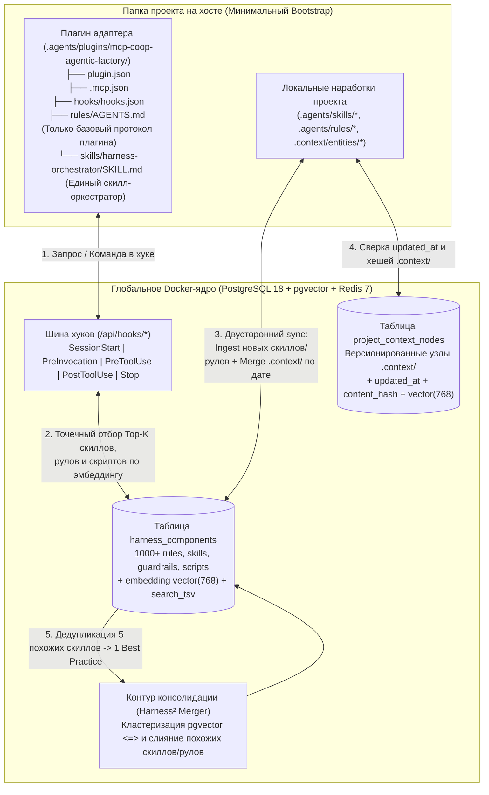

# SPEC-002: Динамический Харнес, Двусторонний `sync` и Консолидация Знаний `Harness²` (v0.2)

> **Статус:** Draft (В очереди на реализацию — v0.2)  
> **Проект:** `mcp-coop-agentic-factory` (`shpakich-agent`)  
> **Назначение:** Архитектурная спецификация перехода от статической выгрузки правил/скиллов к динамической RAG-инъекции через хуки, двусторонней синхронизации (`Workspace <-> PostgreSQL`) и векторной дедупликации/слиянию знаний на сервере.

---

## 1. Суть архитектурного перехода (От статики к динамическому Харнесу)

### 1.1. Что было в версии `v0.1` и почему это ограничивает масштаб
1. **Статическая материализация всех правил и скиллов:** компилятор [`src/core/harness/compiler.py`](../src/core/harness/compiler.py) собирал все подходящие проекту правила (`system_prompt`, `tool_guidance`, `guardrail`) в физический файл `rules/AGENTS.md` и каждый навык (`skill`) — в отдельный файл `skills/<slug>/SKILL.md` внутри папки плагина проекта.
2. **Проблема масштабирования (1000+ правил и скиллов):** когда в базе накапливаются сотни правил и скиллов со всех проектов, их невозможно выгружать на диск — контекстное окно агента переполняется на каждом шаге, срабатывает жёсткое усечение (`MAX_RULES_MARKDOWN_BYTES = 24 KB`), а в проектах плодятся сотни дублирующихся файлов.
3. **Односторонний `sync`:** команда `mcp-coop-agentic-factory sync` работала только в режиме `Docker -> Workspace` (перезаписывая файлы плагина из БД), но не умела забирать локально созданные в проекте скиллы, правила, хуки и узлы `.context/` обратно в глобальную базу.

---

### 1.2. Новая парадигма `v0.2` (`Minimal Bootstrap on Disk + 100% Dynamic Hook RAG in DB`)



---

## 2. Детальная архитектура по 4 контурам

### Контур 1. Что лежит на диске в плагине, а что подгружается через хуки из БД

#### 1.1. Минимальный статический Bootstrap в папке плагина проекта
В папке проекта создаётся только легковесный неизменный каркас, чтобы агент со старта понимал, что он работает внутри `mcp-coop-agentic-factory`:
1. **`plugin.json` + `.mcp.json` + `hooks/hooks.json`** — техническая привязка хуков (`run-hook.sh`) и MCP-сервера (`http://127.0.0.1:8787/mcp`).
2. **Базовый `rules/AGENTS.md` (Bootstrap Protocol)** — содержит **только**:
   - базовые инварианты общения и инженерного режима (`Learning-First`, языковой стандарт, культура Code Review);
   - протокол работы с локальным графом `.context/` (`index.md` -> `entities/`);
   - правила взаимодействия с динамическим харнесом (как агент получает контекстные правила/скиллы от хуков и когда вызывать MCP-инструменты `coop_*`).
3. **Единый скилл-оркестратор `skills/harness-orchestrator/SKILL.md`** — единственный статический скилл на диске. Объясняет агенту:
   - как устроена фабрика (`PostgreSQL + pgvector + Redis`);
   - как искать знания и скиллы через `coop_search_memory`;
   - как предлагать новые правила, скиллы и скрипты в общую базу через `coop_propose_harness_edit` и `coop_publish_skill`;
   - как валидировать и синхронизировать граф `.context/` через `coop_query_context_graph` и `coop_upsert_context_node`.

#### 1.2. Динамическая подгрузка остальных 1000+ правил и скиллов на уровне хуков
Все остальные компоненты (`system_prompt`, `tool_guidance`, `skill`, `guardrail`, `script`) хранятся **только в таблице `harness_components` PostgreSQL** и никогда не копируются файлами в проект. Они применяются автоматически в рантайме:

| Событие хука | Что делает ядро в Docker (`/api/hooks/<event>`) | Что получает агент |
| :--- | :--- | :--- |
| **`SessionStart`** | 1. Запускает скрипты `session-start` из БД (`inject-context-map`).<br>2. Выбирает из `harness_components` правила с `execution_mode = 'always'` под стек проекта (`projects.stack_tags`). | `systemMessage` с картой `.context/index.md` и активными инвариантами стека проекта. |
| **`PreInvocation`** (`UserPromptSubmit`) | 1. Берёт текст запроса пользователя (`prompt`).<br>2. Считает 768-мерный вектор через `EmbeddingClient` (`RETRIEVAL_QUERY`).<br>3. Ищет в `harness_components` по **стеку проекта + `embedding <=> $prompt_vec` + `search_tsv`**:<br>   - **Top-2 релевантных скилла (`component_type = 'skill'`)**;<br>   - **Top-3 доменных правила (`system_prompt`, `tool_guidance`)**;<br>   - **Top-K семантических скриптов (`script`)**.<br>4. Добавляет RAG-решения из `memories`, если в сессии была ошибка. | `ephemeralMessage` (на один шаг), содержащий **только те скиллы и правила, которые нужны для выполнения текущего промпта**. |
| **`PreToolUse`** | Проверяет `guardrail` и запускает подходящие `script` из `harness_components` по вызываемому инструменту/команде. | `allow` / `deny` / `ask` / `overwrite`. |
| **`PostToolUse`** | Запускает скрипты `post-tool-use` из БД (`track-file-changes`), фиксирует ошибки и изменения файлов в Redis. | `{}` (или `ephemeralMessage` при сбое). |
| **`Stop`** | Запускает скрипты `stop` из БД (`enforce-context-sync`), проверяет синхронизацию `.context/` и рефлексию ошибок. | `allow` или `continue` с причиной. |

---

### Контур 2. Двусторонний `sync` (`Ingestion` кастомных скиллов/рулов/хуков проекта в БД)

Когда пользователь или агент создаёт в проекте собственные скиллы, правила или скрипты (в `.agents/skills/*`, `.agents/rules/*`, `.claude/skills/*`, `.cursor/rules/*` или добавляет кастомные файлы в папку плагина) и запускает:
```bash
mcp-coop-agentic-factory sync
```
выполняется **двусторонняя синхронизация**:

#### Шаг 1. Сканирование локальных артефактов проекта (`Workspace Scanner` в CLI)
В [`src/cli/materializer.ts`](../src/cli/materializer.ts) добавляется функция `scanCustomWorkspaceComponents(workspaceRoot, agent)`:
* Сканирует папки правил, скиллов и скриптов проекта (игнорируя два системных bootstrap-файла: базовый `rules/AGENTS.md` и `skills/harness-orchestrator/SKILL.md` по их системной сигнатуре).
* Извлекает из каждого найденного файла:
  - `slug` (по имени папки скилла или имени файла правила/скрипта),
  - `component_type` (`skill`, `system_prompt`, `tool_guidance`, `script`),
  - `title` и `description` (из YAML frontmatter или первого заголовка `# ...`),
  - `content` (полный текст/код),
  - `content_hash` (`sha256`),
  - `file_updated_at` (`mtime` файла в ISO-8601),
  - `stack_tags` (теги текущего проекта из `projects` + теги из frontmatter файла, если указаны).

#### Шаг 2. Выгрузка в PostgreSQL с векторизацией (`POST /api/sync/ingest`)
CLI отправляет найденные локальные компоненты в Docker-ядро:
1. Ядро сверяет каждый компонент по `(slug, content_hash)` с таблицей `harness_components`:
   - Если такого `slug` ещё нет в БД — создаёт новую запись (`source_project_path = workspace_path`, `status = 'composed'`), генерирует вектор `embedding vector(768)` через `EmbeddingClient` (`title + description + content[:2000]`) и сохраняет в PostgreSQL.
   - Если `slug` уже есть, но локальный файл новее (`file_updated_at > db.updated_at` и `content_hash` изменился) — обновляет `content`, `version = version + 1`, пересчитывает `embedding` и обновляет `updated_at`.
2. Все выгруженные из проекта скиллы и правила сразу становятся частью общего пула в PostgreSQL и могут автоматически подтягиваться хуком `PreInvocation` в других проектах с тем же стеком!

---

### Контур 3. Двусторонняя синхронизация и мерж графа `.context/` по дате (`updated_at`)

Чтобы граф знаний проекта `.context/` (`index.md`, `schema.md`, `entities/modules/*.md`, `entities/contracts/*.md`, `entities/decisions/*.md`) хранился и в Git проекта, и в PostgreSQL фабрики, причём при `sync` никогда не перетирался более старой версией:

#### 3.1. Новая таблица в PostgreSQL (`project_context_nodes` в [`src/core/db/postgres.py`](../src/core/db/postgres.py))
```sql
CREATE TABLE IF NOT EXISTS project_context_nodes (
    id UUID PRIMARY KEY DEFAULT gen_random_uuid(),
    project_id UUID NOT NULL REFERENCES projects(id) ON DELETE CASCADE,
    workspace_path TEXT NOT NULL,
    relative_path TEXT NOT NULL,           -- например: 'index.md' или 'entities/modules/mod-bun-cli.md'
    node_id TEXT NOT NULL,                 -- например: 'index' или 'mod-bun-cli'
    entity_class TEXT NOT NULL DEFAULT 'Module',
    content TEXT NOT NULL,
    content_hash TEXT NOT NULL,            -- SHA-256 нормализованного текста
    file_updated_at TIMESTAMPTZ NOT NULL,  -- Время модификации узла
    embedding vector(768),                 -- Вектор узла для семантического поиска по архитектуре проекта
    search_tsv tsvector GENERATED ALWAYS AS (
        to_tsvector('simple', coalesce(node_id, '') || ' ' || coalesce(content, ''))
    ) STORED,
    updated_at TIMESTAMPTZ DEFAULT NOW(),
    UNIQUE (workspace_path, relative_path)
);
```

#### 3.2. Алгоритм сверки и мержа при `mcp-coop-agentic-factory sync` (`POST /api/sync/context`)
При вызове `sync` CLI отправляет список всех файлов `.context/**/*.md` с их `relative_path`, `content_hash`, `file_updated_at` и `content`:

1. **Одинаковый `content_hash` (`unchanged`):** ничего делать не нужно.
2. **Узел есть только на диске (или `local.file_updated_at > db.file_updated_at`):**
   - Локальная версия свежее → ядро обновляет запись в `project_context_nodes`, пересчитывает `embedding vector(768)` и возвращает статус `pushed_to_db`.
3. **Узел есть только в БД (или `db.file_updated_at > local.file_updated_at`):**
   - Например, папка `.context/` была удалена/повреждена или узел был обновлён через MCP-инструмент `coop_upsert_context_node` в Docker → ядро возвращает более свежий контент из БД в CLI, и CLI записывает его на диск (`pulled_from_db`).
4. **Коллизия правок (и на диске, и в БД хеши изменились параллельно):**
   - Выполняется **умный структурный мерж Markdown-узла**:
     - YAML-frontmatter (`files`, `depends_on`, `implements`, `governed_by`) объединяется как множество (union без дубликатов);
     - основное описание берётся из версии с более поздним `file_updated_at`;
     - секция `## Логи контекста (AI Traces)` объединяет строки `- YYYY-MM-DD: ...` из обеих версий в хронологическом порядке без потери истории.

---

### Контур 4. Серверная консолидация знаний (`Skill & Rule Merger` по векторам в БД)

Когда из 5 разных проектов через `sync` в таблицу `harness_components` прилетели похожие скиллы или правила (например, `fastapi-db-pool`, `asyncpg-setup`, `postgres-fastapi-lifespan`), сервер умеет объединять их в один эталонный Best Practice:

#### 4.1. Поиск кластеров похожих компонентов (`pgvector` Cosine Similarity)
Эндпоинт `POST /api/harness/consolidate` (и команда CLI `mcp-coop-agentic-factory harness consolidate` + MCP-тул `coop_consolidate_harness`):
1. Внутри `harness_components` ищутся пары и кластеры компонентов одного типа (`component_type IN ('skill', 'system_prompt', 'tool_guidance')`, `status = 'composed'`), у которых:
   ```sql
   1.0 - (a.embedding <=> b.embedding) >= 0.82
   ```
   (или при выключенном API эмбеддингов — высокая лексическая близость `similarity(a.title || ' ' || a.description, b.title || ' ' || b.description) >= 0.55`).
2. Формируется кластер кандидатов на слияние (например, 3–5 похожих скиллов с пересекающимися `stack_tags`).

#### 4.2. Слияние кластера в единый эталонный компонент (`Compose & Archive`)
1. **Синтез эталона:**
   - Если активен провайдер в `RuntimeProviderPool` (Tier 2 LLM), ему передаются тексты всех компонентов кластера с задачей синтезировать единый, структурированный и без повторов `SKILL.md` / правило, сохранив все уникальные edge-cases и best practices.
   - Если внешние провайдеры отключены — работает детерминированный структурный агрегатор секций Markdown.
2. **Обновление БД в транзакции:**
   - Создаётся/обновляется канонический компонент с объединённым массивом `stack_tags`, повышенным весом `score` и увеличенной `version`.
   - Исходные дублирующиеся записи не удаляются бесследно, а переводятся в статус `status = 'archived'` с записью в `metadata`: `{"merged_into": "<canonical_slug>"}`.

---

## 3. План реализации по этапам (для следующей сессии)

1. **Этап 1 (Минимальный Bootstrap + Динамический `PreInvocation` RAG для скиллов и правил):**
   - Перевести `HarnessCompiler` ([`src/core/harness/compiler.py`](../src/core/harness/compiler.py)) на генерацию только базового Bootstrap-протокола (`rules/AGENTS.md`) и единого скилла-оркестратора (`skills/harness-orchestrator/SKILL.md`).
   - Расширить `hook_pre_invocation` ([`src/core/main.py`](../src/core/main.py)) векторно-лексическим отбором релевантных `skill`, `system_prompt` и `tool_guidance` из `harness_components` под промпт пользователя.
2. **Этап 2 (Двусторонний `sync`: Ingestion локальных скиллов/рулов + синхронизация `.context/` по дате):**
   - Добавить таблицу `project_context_nodes` в [`src/core/db/postgres.py`](../src/core/db/postgres.py).
   - Реализовать эндпоинты `POST /api/sync/ingest` и `POST /api/sync/context` в [`src/core/main.py`](../src/core/main.py).
   - Обновить команду `mcp-coop-agentic-factory sync` в [`src/cli/index.ts`](../src/cli/index.ts) и [`src/cli/materializer.ts`](../src/cli/materializer.ts) для сканирования кастомных скиллов/правил проекта и двустороннего мержа `.context/` по `updated_at` и `content_hash`.
3. **Этап 3 (Консолидация и слияние похожих скиллов/рулов на сервере):**
   - Реализовать сервис кластеризации и слияния `HarnessConsolidator` (`src/core/harness/consolidator.py`), эндпоинт `POST /api/harness/consolidate` и подкоманду CLI `mcp-coop-agentic-factory harness consolidate`.
